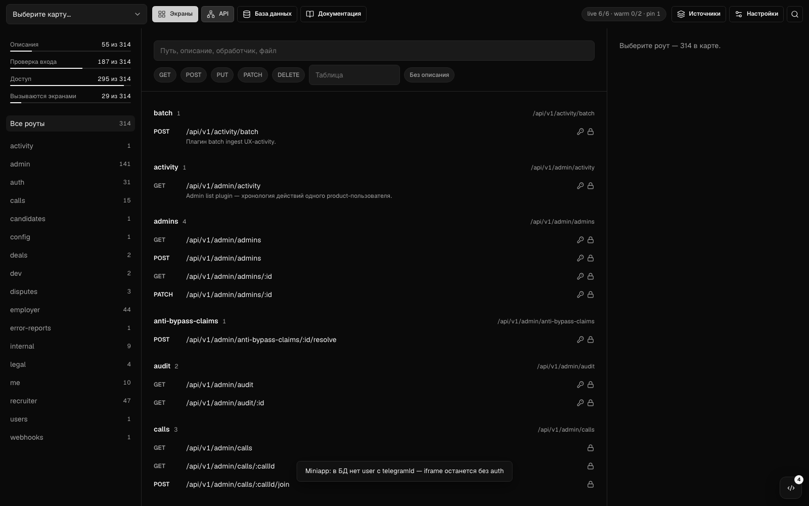
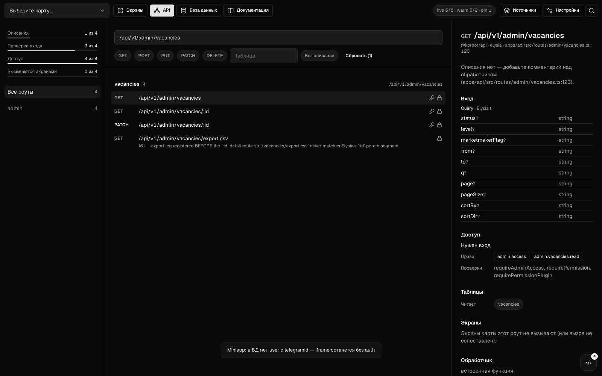
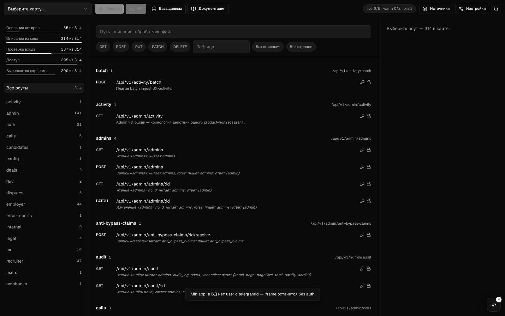
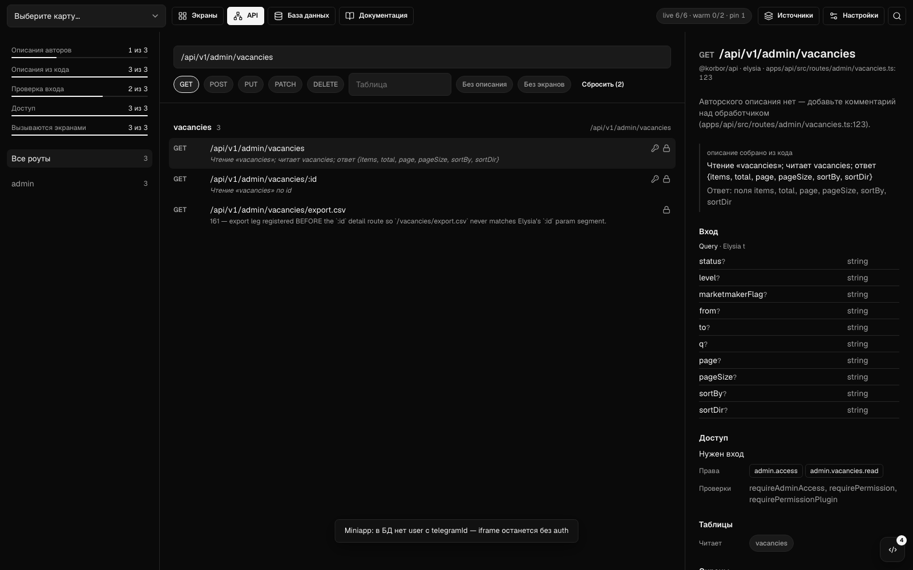
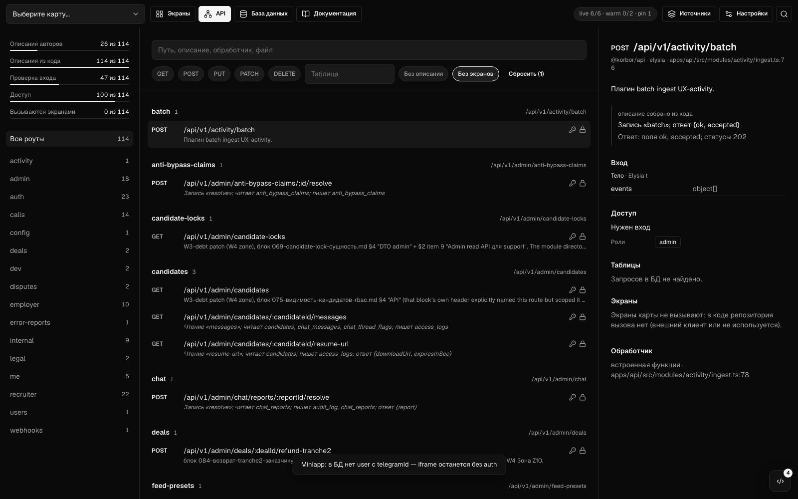

# Проверка

## Цифры до → после

| Карта | Роутов с экранами | Экранов со связями | Вызовов API | Описаний: авторских / из кода |
|---|---|---|---|---|
| korbor-all | 29 → **200** из 314 | 11 → **76** из 77 | 288 → 318 | 55 / 314 |
| vpn-saas admin | 0 → **165** из 293 (роутов было 286: алиасы `@/`) | 0 → **55** из 56 | 212 → 265 | 17 / 289 |
| vpn-saas miniapp | 0 → **25** из 293 | 0 → **14** из 18 | — | — |

«До» korbor — карта из origin/master (1b4f071); «до» vpn — карты прежним сканером.
Экран без связей: korbor — 1 (без вызовов в коде); vpn admin — редирект; miniapp — 4 экрана без API.

## Роуты без экранов — почему (после)

| Карта | Не доходит экран | Не из экранов карты | Вызова нет |
|---|---|---|---|
| korbor-all (114) | 18: оболочка входа admin/miniapp, dogfood, consent, notifications/read | 19: mobile, call-core, call-transcriber, site, platform | 77: 59 без вызова, бот 9, вход/сессия 6, вебхук 3 |
| vpn admin (128) | 9 | 28: miniapp, node, site, subs | 91: 72 без вызова, вход 12, вебхук 4, бот 3 |

Полные списки: [korbor](proofs/no-screens-korbor.md), [vpn admin](proofs/no-screens-vpn-admin.md).
Выборочная проверка 59 «вызова нет» в korbor grep-ом: в клиентском коде путь только в комментариях и
схемах validation — кроме 4 (см. 09-bugs: url-построители, `/${surface}/…` в mobile, activity через конфиг библиотеки).

## Скриншоты

До:  

После:   

## Тесты: реальные вызовы

- `bun test --max-concurrency=1` scanner-source, cli, graph, mcp-server, schema, visualizer-spa/src, scripts — 438 pass, 0 fail.
  Сканер — на фикстуре source-monorepo через `scanSource`; graph/MCP/вид — на настоящей korbor-all.
- e2e (весь прогон, свой dev на :4312 с копией .lam-sessions, живой korbor) — 22 passed.
- typecheck: scanner-source, graph, mcp-server, visualizer-spa.

## Баги

См. 09-bugs.md
